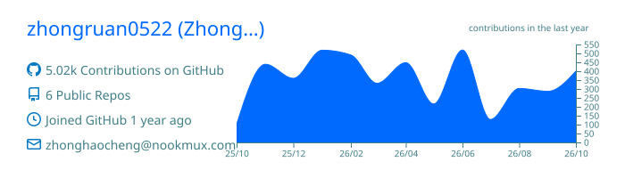
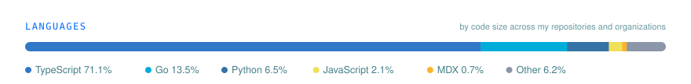
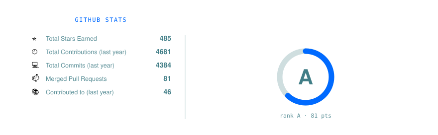

Hi, My name is Zhong Haocheng, and I am currently a student at Jiangxi Modern Polytechnic College, majoring in Computer Network Technology.

I'm glad you visited my homepage.

Below, you can see my GitHub activity data and the projects I’ve been working on recently.

<picture>
  <source media="(prefers-color-scheme: dark)" srcset="./assets/snake-dark.svg">
  
</picture>

Some projects I’ve been tinkering with lately:

- [Cloud-Development](https://github.com/zhongruan0522/Cloud-Development): A container-isolated development environment that allows you to quickly obtain a clean setup.
- [NookMux](https://github.com/NookMux/NookMux): An AI API aggregation gateway that supports a wider range of subscription plans.
- [UnifyNook](https://github.com/UnifyNook/UnifyNook): This is a project currently in the planning stage, which I intend to use for multi-agent aggregation.
- [UnifyGet](https://github.com/UnifyNook/UnifyGet): A comprehensive, high-performance, secure, and controllable integrated acceleration platform for developer resources
- [AntiHub-ALL](https://github.com/NookMux/AntiHub-ALL) and [geminicli2api](https://github.com/NookMux/geminicli2api): Early experimental projects involving various subscription aggregations have now been archived.
